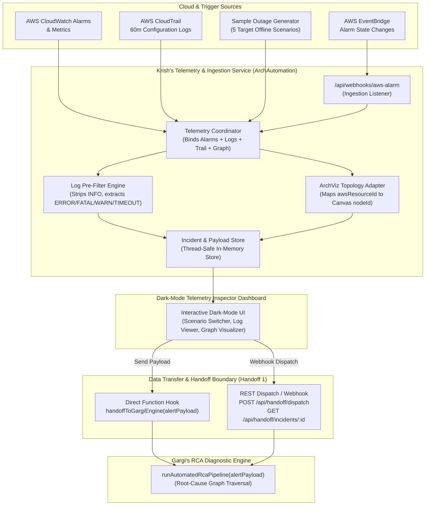

# 🚀 ArchAutomation: AWS Telemetry Ingestion, Log Filtering & RCA Handoff Pipeline

> **Role & Objective:** Standalone Node.js/TypeScript service and dark-mode inspection dashboard that extracts AWS and canvas graph structures from the `archviz` repository, ingests live and simulated AWS failure telemetry, filters noisy logs, and transfers structured `AlertPayload` payloads to Gargi's Diagnostic & Root-Cause Analysis (RCA) Engine.

---

## 📌 Architecture Overview



---

## 📋 Handoff 1 Data Contract (`AlertPayload`)

Every payload collected from AWS and transferred to Gargi strictly adheres to this contract:

```typescript
export interface AlertPayload {
  incidentId: string;
  triggeredAt: string;
  activeAlarms: Array<{
    alarmId: string;
    alarmName: string;
    nodeId: string;          // Node ID in the ArchViz canvas
    awsResourceId: string;   // AWS ARN or Resource ID
    metricName: string;
    metricValue: number;
    threshold: number;
    timestamp: string;
  }>;
  cloudWatchLogs30m: Array<{
    timestamp: string;
    nodeId: string;
    awsResourceId: string;
    level: 'ERROR' | 'FATAL' | 'WARN' | 'TIMEOUT';
    message: string;
  }>;
  cloudTrailEvents60m: Array<{
    eventId: string;
    eventTime: string;
    eventName: string;
    awsResourceId: string;
    userIdentity: string;
    requestParameters: Record<string, unknown>;
  }>;
  canvasGraph: {
    nodes: Array<{ id: string; type: string; awsResourceId: string; data: Record<string, unknown> }>;
    edges: Array<{ id: string; source: string; target: string }>;
  };
}

// Handoff target where Krish's collector passes the data to Gargi:
export async function handoffToGargiEngine(alertPayload: AlertPayload) {
  return await runAutomatedRcaPipeline(alertPayload);
}
```

---

## 🧩 Extracted & Adapted Components from `archviz`

1. **AWS SDK v3 & Credential Patterns (`src/aws/`):**
   - Adapted from `archviz/api/aws-sync.js` and `archviz/scripts/archviz-cli-sync.cjs`.
   - Supports direct IAM credentials (`AWS_ACCESS_KEY_ID`, `AWS_SECRET_ACCESS_KEY`), temporary tokens (`AWS_SESSION_TOKEN`), and enterprise cross-account STS `AssumeRole` (`AWS_ROLE_ARN`, `AWS_ROLE_EXTERNAL_ID`).
   - Seamless fallback to high-fidelity simulation when no credentials are configured.

2. **ArchViz Canvas Graph Structure (`src/types/canvasGraph.ts`):**
   - Exact JSON structure representing canvas topologies: nodes with `id`, `type`, `data`, `awsResourceId` and edges with `id`, `source`, `target`.
   - Indexer helper `buildResourceIndex` and mapper `findNodeIdForResource` which automatically correlates AWS resource ARNs to canvas `nodeId`s so Gargi's graph-traversal engine can trace upstream/downstream connections.

3. **Gargi's Entry Hook Connector (`src/handoff/gargiConnector.ts`):**
   - Adaptable connector for `runAutomatedRcaPipeline(alertPayload)`.
   - Allows direct in-process registration via `registerGargiEngine(handler)` or automatic forwarding to `GARGI_RCA_WEBHOOK_URL`.

---

## ⚡ 5 Realistic Target AWS Outage Scenarios

Built into `src/generator/sampleOutageGenerator.ts` for offline validation and immediate inspection:

| Scenario | Trigger / Metrics | Filtered CloudWatch Logs (30m) | CloudTrail Events (60m) | ArchViz Topology |
| :--- | :--- | :--- | :--- | :--- |
| **1. RDS Database Bottleneck** | `CPUUtilization > 92%`, `DatabaseConnections > 90%` (498/500 conn) | `FATAL: remaining connection slots are reserved for non-replication superuser connections` | `ModifyDBParameterGroup` changing `max_connections` | API Gateway ➔ Lambda ➔ RDS PostgreSQL |
| **2. ECS/EKS Container CrashLoop** | Task stop count > 3 in 10 mins (`ContainerCrashCount: 7`) | Container `Exit Code 137 (OutOfMemoryError)`, V8 JavaScript heap out of memory | `RegisterTaskDefinition` reducing memory limit to 512MB | ALB ➔ ECS Service ➔ ElastiCache Redis |
| **3. Security Group Drift** | AWS Config non-compliant & GuardDuty `Recon:EC2/Portscan` | Suspicious external brute-force SSH & PostgreSQL handshakes | `AuthorizeSecurityGroupIngress` opening ports `22` and `5432` to `0.0.0.0/0` | Internet GW ➔ Security Group ➔ RDS |
| **4. API 5xx Timeouts** | `5XXError > 48%`, `TargetResponseTime > 3000ms` | Lambda `Task timed out after 3.00 seconds`, ALB `504 Gateway Timeout` | `PutScalingPolicy` capping ASG max capacity | CloudFront ➔ ALB ➔ Lambda ➔ DynamoDB |
| **5. FinOps Idle Waste** | 0 IOPS for 7 days on io2 EBS volume, 0 BytesOut on NAT GW | Cost Anomaly Detection alert ($125/mo waste), Trusted Advisor notification | `DetachVolume` leaving volume in `available` unattached state | Legacy VPC ➔ NAT Gateway & Orphaned EBS |

---

## 🖥️ Dark-Mode Telemetry & Handoff Inspector Dashboard

The service serves an interactive, dark-mode inspector view:

- **Scenario Bar:** 1-click trigger for any of the 5 AWS scenarios or live AWS collection.
- **Active Alarms View:** Real-time metrics, crossed thresholds, and canvas node mappings.
- **Filtered Logs Tab:** Pre-filtered log table with noise filter pills (`ALL`, `FATAL`, `ERROR`, `TIMEOUT`, `WARN`).
- **CloudTrail Events Tab:** Chronological mutation history with formatted JSON request parameters.
- **ArchViz Canvas Graph Tab:** Visual topology diagram showing connected cloud nodes and dependency edges.
- **alertPayload.json Tab:** Full syntax-highlighted JSON viewer with copy and download options.
- **"Send Payload to Gargi's Engine" CTA:** Primary action button with live handoff modal confirming schema verification, delivery channel, and diagnostic status.

---

## 🚀 Quickstart

### 1. Installation
```bash
git clone <repo-url>
cd Arch_Automation
npm install
```

### 2. Run in Development Mode
```bash
npm run dev
```
Open **[http://localhost:4000](http://localhost:4000)** in your browser.

### 3. Production Build & Start
```bash
npm run build
npm start
```

### 4. Run Test Suite
```bash
npm test
```
Runs 22 comprehensive unit and integration tests covering:
- Strict `AlertPayload` schema compliance (Handoff 1)
- Log pre-filtering and noise suppression
- All 5 AWS outage scenarios
- Gargi handoff connector (direct function & REST webhook dispatch)
- Webhook endpoints & incident retrieval

---

## 🛠️ CLI Tools

### Inspect & Validate Any Payload File or Scenarios
```bash
# Validates all 5 scenarios against the Handoff 1 contract
npm run inspect

# Or inspect a custom JSON file
npx tsx scripts/inspect-payload.ts --file alertPayload-container_crashloop.json
```

### Simulate an Alarm and Save/Handoff Payload
```bash
# Simulate scenario and print summary
npm run simulate -- --scenario rds_bottleneck

# Save payload to JSON and execute handoff to Gargi's engine
npm run simulate -- --scenario container_crashloop --save --handoff

# Post to running webhook
npm run simulate -- --scenario security_group_drift --post http://localhost:4000/api/webhooks/aws-alarm
```

---

## 🌐 API Reference

### 1. Ingestion Webhook Listener
- **Endpoint:** `POST /api/webhooks/aws-alarm`
- **Headers:** `Content-Type: application/json`
- **Supported Bodies:**
  - AWS EventBridge CloudWatch Alarm State Change events
  - AWS SNS Alarm Notification wrappers
  - Direct manual trigger: `{ "scenario": "rds_bottleneck" }` or `{ "awsResourceId": "db-prod", "metricName": "CPUUtilization", "threshold": 90 }`

### 2. Gargi Handoff Endpoints
- **List Incidents:** `GET /api/handoff/incidents`
- **Retrieve AlertPayload JSON:** `GET /api/handoff/incidents/:id` (append `?download=true` for file download)
- **Dispatch to Gargi:** `POST /api/handoff/dispatch`
  - Body: `{ "incidentId": "inc-rds-bottleneck" }` or `{ "payload": alertPayload, "webhookUrl": "http://gargi-service/rca" }`

### 3. Scenarios & AWS Endpoints
- **Trigger Scenario:** `POST /api/scenarios/trigger/:scenarioId`
- **List Scenarios:** `GET /api/scenarios/list`
- **AWS Status:** `GET /api/aws/status`
- **Live AWS Ingest:** `POST /api/aws/live-collect`

---

## 📁 Repository Directory Structure

```
Arch_Automation/
├── src/
│   ├── types/
│   │   ├── alertPayload.ts         # Strict Handoff 1 AlertPayload interface
│   │   ├── canvasGraph.ts          # ArchViz node/edge definitions & resource indexer
│   │   └── aws.ts                  # EventBridge, SNS, and CloudWatch event schemas
│   ├── aws/
│   │   ├── credentials.ts          # Direct & STS AssumeRole credential resolver
│   │   ├── clientManager.ts        # AWS SDK v3 client factories (CW, Logs, Trail)
│   │   └── resourceDiscovery.ts    # Adapted multi-resource discovery & graph builder
│   ├── collector/
│   │   ├── logFilter.ts            # Pre-filter: strips INFO, classifies ERROR/FATAL/WARN/TIMEOUT
│   │   ├── cloudWatchCollector.ts  # 30-min log queries and active alarm fetcher
│   │   ├── cloudTrailCollector.ts  # 60-min CloudTrail configuration mutation lookups
│   │   └── telemetryCoordinator.ts # Ingestion coordinator binding all 4 sources
│   ├── generator/
│   │   ├── sampleOutageGenerator.ts # Mock generator for all 5 target AWS failure scenarios
│   │   └── mockGraphs.ts           # Authentic ArchViz canvas graph topologies
│   ├── handoff/
│   │   ├── gargiConnector.ts       # handoffToGargiEngine & runAutomatedRcaPipeline connector
│   │   └── webhookDispatcher.ts    # REST webhook POST dispatcher
│   ├── store/
│   │   └── incidentStore.ts        # Thread-safe in-memory incident & alert store
│   ├── api/
│   │   ├── webhooks.ts             # POST /api/webhooks/aws-alarm
│   │   ├── handoffRoutes.ts        # GET /incidents, GET /incidents/:id, POST /dispatch
│   │   ├── scenarioRoutes.ts       # POST /api/scenarios/trigger/:scenarioId
│   │   └── liveAwsRoutes.ts        # Live AWS scan and query routes
│   ├── public/
│   │   ├── index.html              # Dark-mode dashboard UI
│   │   ├── app.js                  # Client logic, scenario switcher, handoff modal
│   │   └── styles.css              # Custom dark-theme styling
│   └── index.ts                    # Server startup & programmatic exports
├── scripts/
│   ├── simulate-alarm.ts           # CLI alarm simulator & dispatcher
│   ├── inspect-payload.ts          # CLI contract validator
│   └── copy-public.cjs             # Asset build packager
├── tests/
│   ├── contract.test.ts            # AlertPayload schema compliance tests
│   ├── logFilter.test.ts           # Noise stripping & classification tests
│   ├── scenarioGenerator.test.ts   # 5 failure scenario validation tests
│   ├── handoff.test.ts             # Direct & webhook handoff tests
│   └── webhooks.test.ts            # API route integration tests
├── package.json
├── tsconfig.json
└── README.md
```

---

## 🔒 Security & Best Practices

- **Zero Hardcoded Secrets:** Credentials read securely from environment or STS AssumeRole temporary sessions.
- **Safe Sandboxing:** Offline simulation ensures full diagnostic and graph inspection capabilities without requiring live AWS account access.
- **Contract Enforcement:** All outgoing payloads are strictly validated before dispatching to Gargi's engine to prevent downstream schema drift.
